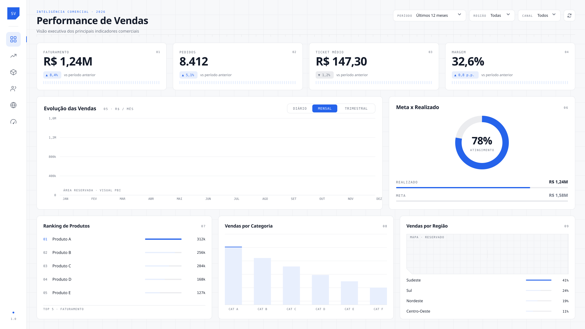
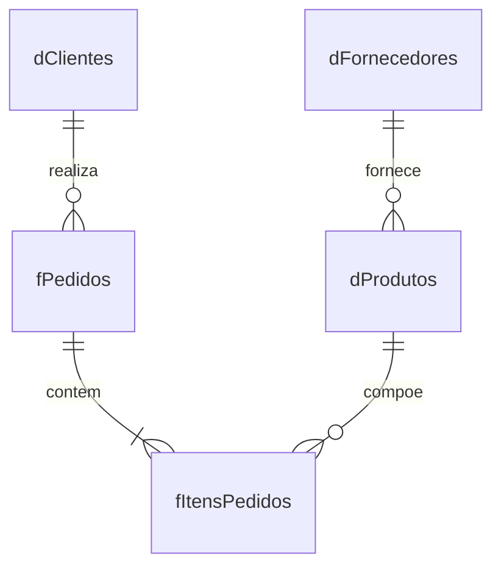

# SunFlow — Base de Dados Comercial Sintética

<p align="center">
  <picture>
    <source media="(prefers-color-scheme: dark)" srcset="assets/dashboard-vendas-dark.svg">
    <source media="(prefers-color-scheme: light)" srcset="assets/dashboard-vendas-light.svg">
    
  </picture>
</p>

<p align="center">
  <strong>250 mil pedidos · 750 mil itens · ~R$ 1 bilhão em faturamento sintético</strong><br>
  Dados 100% fictícios, prontos para estudo de Power BI, SQL, ETL e engenharia de dados.
</p>

---

## Sobre o Projeto

Este repositório contém um **conjunto de dados comercial inteiramente sintético**, modelado nos moldes de uma operação de e-commerce/varejo multissetorial brasileira. A empresa fictícia **SunFlow** opera entre janeiro de 2023 e junho de 2026, vendendo por quatro canais (e-commerce, marketplace, loja física e televendas) e aceitando quatro formas de pagamento (Pix, cartão de crédito, boleto e carteira digital).

Todos os nomes, empresas, marcas e transações são **gerados artificialmente** — não representam pessoas ou negócios reais. A semente de geração (`20260709`) garante reprodutibilidade total.

O projeto inclui:

- **5 arquivos CSV** com dados relacionais completos (dimensões + fatos)
- **1 arquivo Power BI (.pbix)** com dashboard analítico montado
- **Script DDL PostgreSQL** para carga em banco relacional
- **Documentação completa** (dicionário de dados, modelo relacional, regras de negócio)

---

## Estrutura do Repositório

```
├── assets/
│   ├── dashboard-vendas-dark.svg     # Preview do dashboard (tema escuro)
│   ├── dashboard-vendas-light.svg    # Preview do dashboard (tema claro)
│   └── preview.html                  # Visualização local dos SVGs
├── dados/
│   ├── dClientes.csv                 # 50.000 clientes
│   ├── dFornecedores.csv             # 500 fornecedores
│   ├── dProdutos.csv                 # 10.000 produtos
│   ├── fPedidos.csv                  # 250.000 pedidos
│   └── fItensPedidos.csv             # 750.000 itens de pedido
├── documentacao/
│   ├── dicionario_dados.md           # Descrição de cada coluna
│   ├── modelo_relacional.md          # Diagrama ER e direção de filtro
│   ├── regras_negocio.md             # Fórmulas, códigos e premissas
│   └── README.md                     # Índice da documentação
├── sql/
│   └── create_tables_postgresql.sql  # DDL com PKs, FKs e índices
├── manifesto.json                    # Metadados e totais da geração
├── validacao_integridade.json        # Resultado das validações aplicadas
├── PROJETO 32 - Case-Comercial Sintetico.pbix  # Dashboard Power BI (~51 MB)
└── README.md                         # Este arquivo
```

---

## Dados em Números

| Arquivo | Registros | Granularidade |
|---|---:|---|
| `dClientes.csv` | 50.000 | Um cliente por linha |
| `dFornecedores.csv` | 500 | Um fornecedor por linha |
| `dProdutos.csv` | 10.000 | Um produto por linha |
| `fPedidos.csv` | 250.000 | Um pedido por linha |
| `fItensPedidos.csv` | 750.000 | Um item de pedido por linha |

### Indicadores Consolidados

| Indicador | Valor |
|---|---:|
| Quantidade total de unidades | 1.515.638 |
| Valor bruto | R$ 1.011.860.791,04 |
| Valor de desconto | R$ 33.862.277,57 |
| Valor de frete | R$ 550.153,55 |
| **Valor líquido** | **R$ 978.548.667,02** |

### Distribuição de Status

**Pedidos:**

| Status | Quantidade |
|---|---:|
| Entregue | 222.527 |
| Em Transporte | 15.048 |
| Aprovado | 7.516 |
| Pendente | 3.677 |
| Cancelado | 1.232 |

**Itens:**

| Status | Quantidade |
|---|---:|
| Faturado | 651.218 |
| Em Transporte | 45.144 |
| Aguardando Faturamento | 22.548 |
| Devolvido | 16.363 |
| Pendente | 11.031 |
| Cancelado | 3.696 |

---

## Modelo de Dados

```
dFornecedores ─── 1:N ──→ dProdutos ─── 1:N ──→ fItensPedidos ←── N:1 ─── fPedidos ←── N:1 ─── dClientes
```



**Direção de filtro no Power BI:** das dimensões para os fatos, com cardinalidade 1:N e filtro em sentido único. Não relacione `dClientes` diretamente a `fItensPedidos` — o caminho correto passa por `fPedidos`.

---

## Domínios do Negócio

### Categorias de Produto

| Categoria |
|---|
| Beleza e Saúde |
| Casa e Decoração |
| Escritório |
| Esporte e Lazer |
| Tecnologia |

### Segmentos de Cliente

| Segmento |
|---|
| Pessoa Física |
| Pessoa Jurídica |
| Atacado |

### Canais de Venda

| Código | Canal |
|---:|---|
| 1 | E-commerce |
| 2 | Marketplace |
| 3 | Loja Física |
| 4 | Televendas |

### Formas de Pagamento

| Código | Forma |
|---:|---|
| 1 | Pix |
| 2 | Cartão de Crédito |
| 3 | Boleto |
| 4 | Carteira Digital |

### Cobertura Geográfica

Clientes e fornecedores distribuídos em **15 UFs**: AM, BA, CE, DF, GO, MG, MS, MT, PA, PE, PR, RJ, RS, SC, SP.

---

## Fórmulas e Regras Calculadas

### Nível do Item (`fItensPedidos`)

```
ValorBrutoItem    = Quantidade × PrecoUnitario
ValorLiquidoItem  = ValorBrutoItem − ValorDescontoItem
CustoTotalItem    = Quantidade × CustoUnitario
MargemBruta       = ValorLiquidoItem − CustoTotalItem
PercentualMargem  = MargemBruta ÷ ValorLiquidoItem
```

### Nível do Pedido (`fPedidos`)

```
QuantidadeItens = SOMA(fItensPedidos[Quantidade]) por IdPedido
ValorBruto      = SOMA(fItensPedidos[ValorBrutoItem]) por IdPedido
ValorDesconto   = SOMA(fItensPedidos[ValorDescontoItem]) por IdPedido
ValorLiquido    = ValorBruto − ValorDesconto + ValorFrete
```

> Os valores foram calculados em centavos durante a geração — a reconciliação monetária entre pedido e itens não sofre erro de arredondamento.

---

## Como Usar

### Power BI

1. Abra o arquivo `PROJETO 32 - Case-Comercial Sintetico.pbix` no Power BI Desktop.
2. O dashboard já contém o modelo de dados carregado e visualizações prontas.

### SQL (PostgreSQL)

1. Execute o script `sql/create_tables_postgresql.sql` para criar as tabelas.
2. Carregue os CSVs na ordem de dependência:

```
dFornecedores → dProdutos → dClientes → fPedidos → fItensPedidos
```

### Importação Genérica (CSV)

| Parâmetro | Valor |
|---|---|
| Codificação | UTF-8 |
| Delimitador | Vírgula (`,`) |
| Separador decimal | Ponto (`.`) |
| Formato de data | ISO `AAAA-MM-DD` |
| Símbolo monetário | Nenhum |
| Campos vazios em datas | Representam `NULL` |

Todos os CSVs possuem cabeçalho com os nomes de coluna definidos no [dicionário de dados](documentacao/dicionario_dados.md).

---

## Limitações Intencionais

Esta é uma base **sintética e didática**, não uma simulação contábil completa. O conjunto **não inclui**:

- Impostos (ICMS, IPI, ISS, PIS/COFINS)
- Parcelas de pagamento
- Controle de estoque
- Devoluções e estornos financeiros
- CEP ou endereço detalhado
- Dados pessoais reais (CPF, CNPJ, e-mail)
- Dimensão calendário
- Dimensões separadas de canal e forma de pagamento

Itens cancelados ou devolvidos **não** são estornados automaticamente. Para análises de receita realizada, aplique filtro de status ou crie uma regra de estorno explícita no ETL.

Esses itens podem ser adicionados como camada adicional de modelagem e são ótimos exercícios para aprofundar o estudo.

---

## Validações Aplicadas

O conjunto passou por validação automatizada que cobre:

- Cabeçalhos e quantidade de colunas
- Volumes esperados por tabela
- Unicidade das chaves primárias
- Integridade referencial das chaves estrangeiras
- Somente produtos ativos presentes nos fatos
- Consistência cronológica das datas
- Fórmulas monetárias por pedido e por item
- Reconciliação completa de quantidade, bruto, desconto e líquido entre pedidos e itens

**Resultado:** aprovado. Detalhes em [`validacao_integridade.json`](validacao_integridade.json).

---

## Documentação Detalhada

| Documento | Conteúdo |
|---|---|
| [Dicionário de dados](documentacao/dicionario_dados.md) | Tipo, descrição e granularidade de cada coluna |
| [Modelo relacional](documentacao/modelo_relacional.md) | Diagrama ER e direção de filtro |
| [Regras de negócio](documentacao/regras_negocio.md) | Fórmulas, códigos de apoio, status e premissas |

---

## Casos de Uso Sugeridos

- **Power BI:** modelagem dimensional, DAX, drill-through, segmentação por canal/segmento
- **SQL:** JOINs, agregações, CTEs, window functions, análise de coorte
- **ETL:** carga incremental, tratamento de nulos, cálculo de métricas derivadas
- **Python / R:** análise exploratória, visualizações, machine learning (previsão de churn, segmentação)
- **Engenharia de dados:** ingestão em data lake, particionamento, schema evolution

---

## Tecnologias

<p>
  
  
  
</p>

---

## Licença

Este projeto é disponibilizado para **fins educacionais e de estudo**. Os dados são inteiramente fictícios e podem ser usados livremente em projetos pessoais, portfólios e demonstrações técnicas.

---

## Autor

**Nilvan Felipe**

<p>
  <a href="https://github.com/nilvanfelipe"></a>
  <a href="https://www.linkedin.com/in/nilvanfelipe/"></a>
</p>
