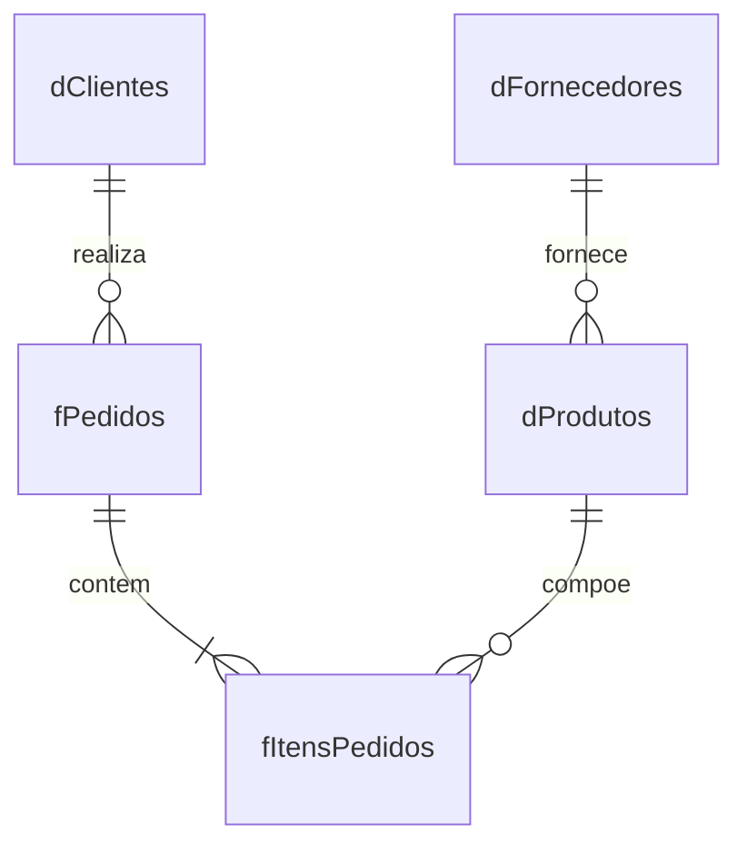

# Modelo relacional



```text
dFornecedores 1 ---- N dProdutos 1 ---- N fItensPedidos N ---- 1 fPedidos N ---- 1 dClientes
```

Direcao recomendada de filtro no Power BI: das dimensoes para as tabelas fato, com relacionamento de cardinalidade um-para-muitos e filtro em sentido unico. Nao relacione `dClientes` diretamente a `fItensPedidos`; o caminho correto passa por `fPedidos`.
